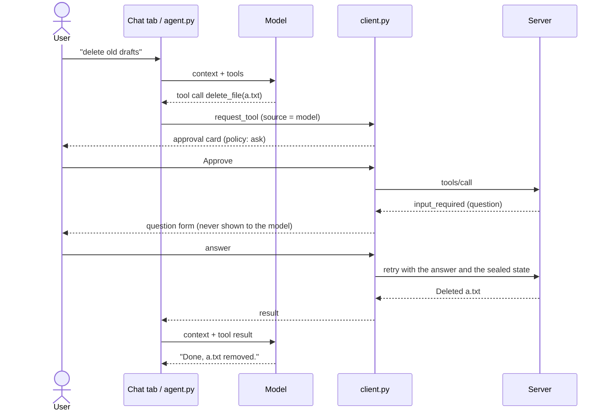

# Part 2: model in the loop

[← README](../README.md) · [Part 1: controls](part-1-controls.md) · [Part 2: model in the loop](part-2-host.md) · [Development](development.md)

`client/host.py` is the Part 1 app plus a **Chat** tab. A model calls the server's tools through the same client as the Tools tab, so every call meets the same policy, approval and audit described in [Part 1](part-1-controls.md). The server's questions come to you, never to the model.

## Running it

Set up the venv first ([Development](development.md#setup)).

```bash
python3 client/host.py server/server.py

* Running on local URL:  http://127.0.0.1:7864
```

It runs on port 7864, so it can sit beside the Part 1 app. The model is any OpenAI-compatible chat-completions endpoint, set by three environment variables:

| Setup | Variables |
|---|---|
| Local, free (default) | none: `ollama pull qwen2.5:7b`, then `ollama serve` |
| OpenAI | `HOST_MODEL_BASE_URL=https://api.openai.com/v1` `HOST_MODEL=<model>` `HOST_MODEL_API_KEY=<key>` |
| Anthropic | `HOST_MODEL_BASE_URL=https://api.anthropic.com/v1/` `HOST_MODEL=<Claude model>` `HOST_MODEL_API_KEY=<key>` |

## A turn

One turn, when `delete_file` is set to *ask*:



What the model gets back for each call:

| Outcome | Tool result the model sees |
|---|---|
| Success | The server's text, verbatim |
| Server error | `Error: <message>` |
| Policy deny | `Denied by client policy` |
| You reject it | `Rejected by the user` |
| Unknown tool / bad arguments | `Error: unknown tool <name>` / `Error: arguments were not valid JSON` (not sent) |
| The question closed first (timeout, folder change) | `Error: the server's question was closed before it was answered` |

## Limits, resources and prompts

A turn stops after 8 tool rounds, to bound cost and runaway loops. **Resources and prompts** enter the conversation only when you pick them under *Add context*: a resource (`workspace://<path>`, read through the same allowed-folder check as `read_file`) goes with your next message, and a server prompt's messages join the conversation. The model can't fetch either.

## A baseline, on purpose

**This is a baseline, on purpose.** It has Part 1's controls and nothing specific to models. Tool descriptions and results reach the model verbatim, the model sees every tool (a denied one is refused when called, and the refusal is audited), and the model's replies render as Markdown. The next step shows attacks landing on this baseline, then adds a defence for each.

## Tests

The tests use a scripted model with the real client and server, and check what the model was sent, both audit logs and the workspace. To run the one test against a real model:

```bash
HOST_MODEL=qwen2.5:7b pytest tests/test_live_model.py
```
