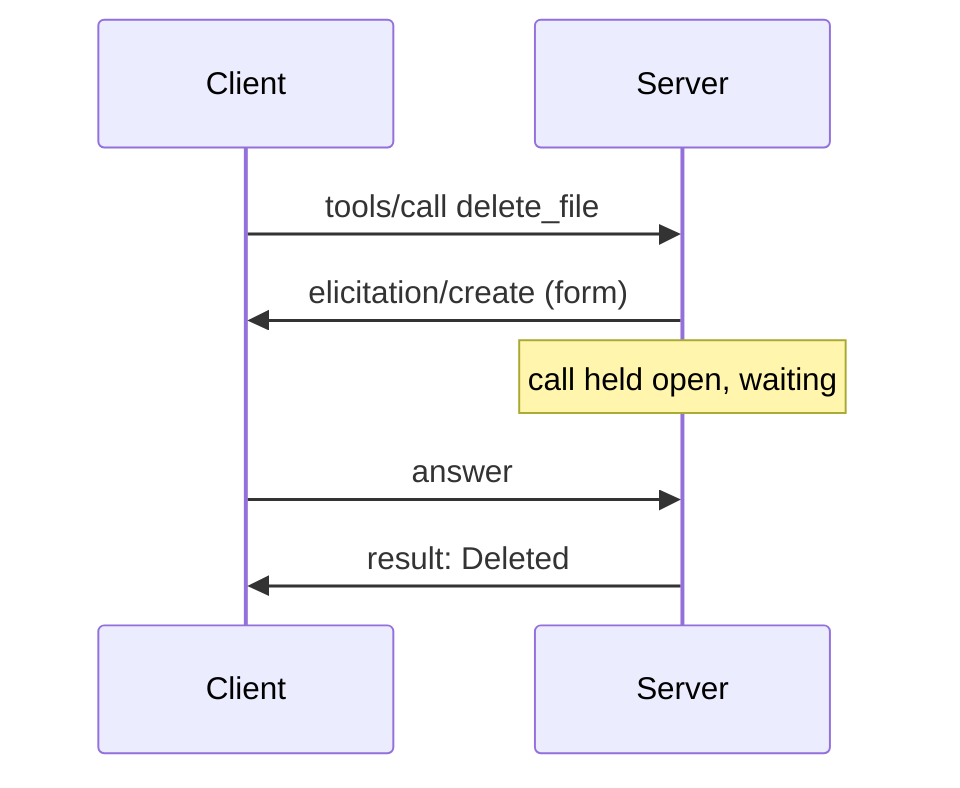

# Bridge post (Part 1 on MCP 2026-07-28): plan

Spec: docs/superpowers/specs/2026-10-19-bridge-post-design.md
Blog repo: `../dominicfarr.github.io`. No commits, no staging, in either repo.

**Goal:** one standalone post explaining the move from handshake-era elicitation and roots to
2026-07-28 MRTR and an allowed folder, backed by pinned snippets and tests.

**Architecture:** a Jekyll post in the series format, two glossary entries plus two one-line
edits, the two Part 1 notes relinked, and a one-line README link here. Verified by a snippet
checker that reads each snippet's pinned commit, a local build, Mermaid rendering, and a reviewer.

**Tech stack:** Jekyll (minima 2.5, gems under the scratchpad's `BUNDLE_PATH`), Mermaid 11
(already wired in `_includes/footer.html`), `@mermaid-js/mermaid-cli`, puppeteer, Python 3.

## Global constraints

- `BEFORE = 7c1324c7d00fa524b1340236894cc83992f720dc`, `AFTER = 096d5accedffc2c407adb3f450bf6e32d947b840`.
- Link form: `https://github.com/dominicfarr/mcp-secuirty-working-notes-example/blob/<SHA>/<path>#L<a>-L<b>`,
  written after each snippet as `[Full source](…)` (the form the checker matches).
- Post file `_posts/2026-10-19-mcp-security-mrtr.md`; front matter `layout: post`,
  `title: "MCP stopped waiting: roots and elicitation on 2026-07-28"`, `date: 2026-10-19`,
  `tags: [agentic, tooling, security]`, `mermaid: true`.
- Prose 1,000–1,300 words (fenced code, Mermaid, front matter excluded). Snippets ≤ 20 lines,
  verbatim, trimmed only with a `# …` line.
- Mermaid: `default` theme only (the site is always light).
- Never touch port 7863 or the user's processes; kill only PIDs started here.
- `S` below = this session's scratchpad
  (`/private/tmp/claude-502/-Users-dom-Projects-mcp-secuirty-working-notes-example/ac2673b7-3a66-4de6-9c51-fd1f6e652aef/scratchpad`).

## Review focus

1. A snippet copied from the working tree (`096d5ac`) but linked to `BEFORE`, or the reverse:
   the checker must read each link's own SHA, not the working tree.
2. Spec wording paraphrased as a quote: every quoted MUST/SHOULD must appear verbatim on the
   2026-07-28 page it links.
3. A claim the code doesn't make, e.g. "the seal is single-use" or "fastmcp checks the identity":
   the seal is not single-use; the identity check is ours, in `delete_file`.
4. Homepage excerpt changed: the Part 1 notes must stay after the first paragraph.
5. A test name in Proof that doesn't exist at `AFTER` (renames during the migration).

---

## Task 1: baseline and per-commit snippet checker

1. In the blog repo: `BUNDLE_PATH=$S/bundle bundle exec jekyll build -d $S/site` succeeds before
   any change; `git status` clean. Note existing warnings.
2. Write `$S/verify_pinned.py`: same matching as `$S/verify_tree.py`, but (a) takes post paths
   as arguments, (b) captures the 40-char SHA from each link and reads the target with
   `git -C <repo> show <sha>:<path>`, (c) also reports a link whose path doesn't exist at its SHA.
   Prints `N snippets checked` and `no problems` or one line per mismatch; exits 1 on problems.
3. Prove it fails: a scratch post in `$S` with one snippet from `AFTER`'s `delete_file` linked to
   `BEFORE` at the same lines → expected: mismatch reported, exit 1. Then link it to `AFTER` →
   `1 snippets checked`, `no problems`.

## Task 2: spec quotes

Fetch (ctx_fetch_and_index) the 2026-07-28 specification pages: the MRTR / `input_required` page
(security considerations for `requestState`), the roots page (deprecation notice, SEP-2577), and
the changelog entry. Record in `$S/quotes.md` the exact sentences to quote, each with its URL.
Expected: sentences for (a) treat as attacker-controlled / integrity protection, (b) bind to
principal, expiry, originating request, (c) single-use / replay is the server's job, (d) client
echoes unchanged on a new request, (e) roots deprecated with configuration as replacement. Any
that doesn't exist verbatim is paraphrased in the post without quote marks, and noted for the
reviewer.

## Task 3: glossary

In `_glossary/` (format of `roots.md`: `title` front matter, 1–3 plain sentences):

- New `mrtr.md` (title "Multi round-trip requests (MRTR)"): instead of sending the client a
  request mid-call and waiting, a server on MCP 2026-07-28 ends the call with an `input_required`
  result holding its questions and an opaque `requestState`. The client gets the answers and
  sends the call again, as a new request, with the answers and the state unchanged. No request
  stays open while a person thinks.
- New `request-state.md` (title "Request state"): the opaque string an MRTR server hands the
  client between rounds and gets back on the retry. It passes through the client, so the server
  must treat it as attacker-controlled: seal it (encrypt and integrity-check), and bind it to the
  request and an expiry.
- `roots.md`: append "Roots are deprecated as of MCP 2026-07-28 (SEP-2577); servers take the
  folders they may use from their own configuration instead."
- `elicitation.md`: append "On MCP 2026-07-28 the question is no longer a mid-call request: it
  travels inside an `input_required` result, and the answer comes back on the retried call (see
  [MRTR](/glossary/mrtr/))."

Build: `/glossary/mrtr/index.html` and `/glossary/request-state/index.html` exist.

## Task 4: draft the post

Write `_posts/2026-10-19-mcp-security-mrtr.md`: the six sections of the spec, §1, then the
migration checklist and footer. Section content is the spec's; snippets and links are fixed here.

**Diagrams** (section 4):



```mermaid
sequenceDiagram
    participant C as Client
    participant S as Server
    C->>S: tools/call delete_file (round 1)
    S->>C: input_required: question + sealed requestState
    Note over S: nothing held; call is over
    C->>S: tools/call delete_file (round 2): same arguments, answers, requestState unchanged
    Note over S: unseal, re-resolve path, compare identity
    S->>C: result: Deleted
```

**Snippets** (each followed by `[Full source](…)`):

| # | What | SHA | Path | Lines |
|---|---|---|---|---|
| 1 | `delete_file` before (docstring trimmed with `# …`) | BEFORE | `server/server.py` | L265-L289 |
| 2 | `delete_file` after (docstring trimmed) | AFTER | `server/server.py` | L265-L289 |
| 3 | `ask_to_confirm`: what goes into the state (capability check and message trimmed) | AFTER | `server/server.py` | L184-L202 |
| 4 | `ModernProtocolOnly` + `mcp = FastMCP(... RequestStateSecurity.ephemeral ...)` | AFTER | `server/server.py` | L50-L62 |
| 5 | Client round loop `_call_server` (docstring trimmed) | AFTER | `client/client.py` | L370-L386 |
| 6 | `resolve_allowed` | AFTER | `server/server.py` | L130-L135 |

**Proof links** (at AFTER): `tests/test_request_state.py`; `tests/test_approval.py#L51`
(`test_retry_sends_the_approved_arguments`); `tests/test_elicitation.py#L122`
(`test_expired_confirmation_deletes_nothing`), `#L203` (`test_file_changed_between_rounds_is_not_deleted`),
`#L134` (`test_file_removed_between_rounds_is_reported`); `tests/test_workspace.py#L44`
(`test_symlink_swapped_between_rounds_is_not_followed`); `tests/test_connection.py#L59`
(`test_client_speaks_2026_07_28`), `#L67` (`test_handshake_client_is_refused`); `tests/test_folder.py`.

**Migration checklist** (bullets): pick 2026-07-28 or the handshake era per server, not both on
one asking path; turn each `await ctx.elicit(...)` into return-`InputRequiredResult` plus a
next-round branch; put what the answer must be checked against in `requestState`, sealed, with an
expiry replacing the old wait timeout; re-check everything on the retry (path, permissions, the
file's identity), since it is a new request; make destructive retries idempotent, because the
seal doesn't stop replay; replace roots with launch configuration; in the client, re-send the
approved arguments, never ones rebuilt from the model or the UI.

**Glossary links** on first use: MCP, MCP client/server, tool call, elicitation, roots, MRTR,
request state, TOCTOU, fail-closed.

**Footer:** Part 1 hub · Roots · Elicitation · One delete, every check (`post_url`).

Run `python3 $S/verify_pinned.py _posts/2026-10-19-mcp-security-mrtr.md` → `6 snippets checked`,
`no problems`.

## Task 5: relink and repo notes

1. Blog: in `2026-10-01-mcp-security.md` and `2026-10-03-mcp-security-roots.md`, replace the
   Versions link in the dated note with `[what changed]()`
   (keep the rest of the note; it stays after the first paragraph).
2. This repo: README Versions section, one line: "What changed and why the guarantees still hold:
   [MCP stopped waiting](https://www.domfarr.com/2026/10/19/mcp-security-mrtr.html)." Migration
   spec §7: append "(Now linked to the bridge post.)" to the Part 1 notes bullet.
3. Build; the two built pages contain a link to `/2026/10/19/mcp-security-mrtr.html`; the
   homepage excerpts for both posts are unchanged (compare `$S/site/index.html` with the baseline
   build's excerpts).

## Task 6: verify

1. `humanizer` pass on the post; re-run `verify_pinned.py` afterwards.
2. Word count: strip front matter, fenced blocks, and link URLs; count → 1,000–1,300.
3. Mermaid: each block to SVG with `npx -y @mermaid-js/mermaid-cli` in `$S` → both render. Serve
   `$S/site` on port 7899 (record the PID), load the post in puppeteer, confirm two rendered
   `svg` inside `pre.mermaid`, screenshot to `$S/bridge.png`, kill that PID.
4. Links: every `/glossary/<x>/` has a file; every repo link's path exists at its SHA (checker);
   every `#L<n>` test link lands on the `def test_…` line named beside it.
5. `git status` in both repos: only the expected files changed, nothing staged.

## Task 7: review

One fresh reviewer subagent (opus) with the spec, this plan, the post, the glossary diffs, the
note diffs, and this plan's Review focus verbatim. Critical/Important findings are fixed and the
checks in Task 6 re-run; minors are reported to the user. Then update memory (`mcp-demo-scope.md`:
bridge post written; next is sub-project 3, the LLM host).
