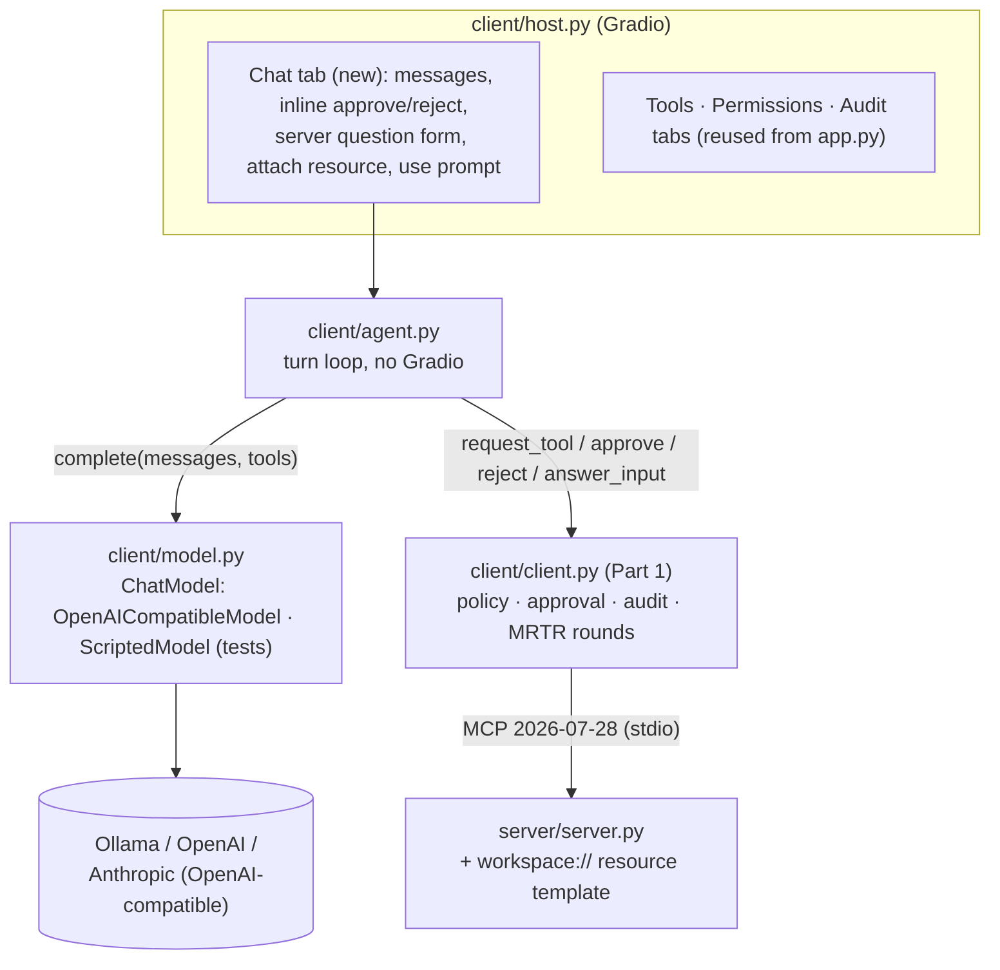
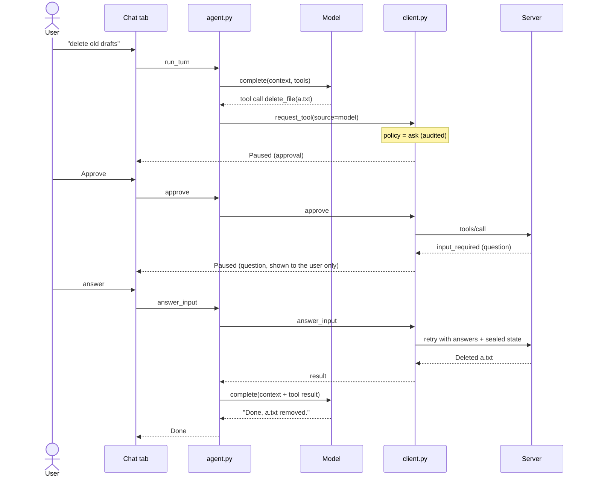
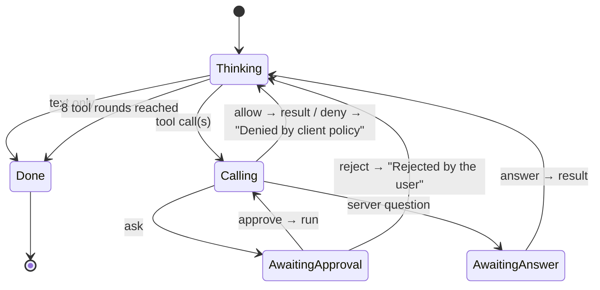
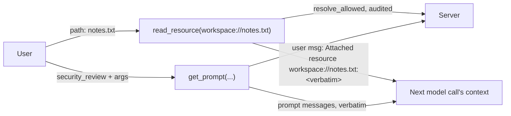
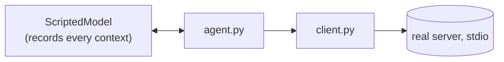

# LLM host (Part 2, sub-project 3)

Date: 2026-10-20
Status: implemented, not committed (plan: docs/superpowers/plans/2026-10-20-llm-host.md)

## Purpose

Part 2 puts a model in the loop. This sub-project builds the host: a chat in which a model calls
the server's tools through the same client Part 1 built, so every model call meets the same
policy, approval, audit and server checks. It is the **baseline** that sub-project 4 attacks: it
has Part 1's controls and nothing LLM-specific, so each attack can be shown landing before its
defence is added.

Success: `python client/host.py` opens the Part 1 app plus a Chat tab; a model (local Ollama by
default, or any OpenAI-compatible endpoint) can read, write and delete files through the policy;
`ask` pauses the turn for the human; server questions go to the human, never the model; resources
and prompts enter the context only when the user picks them; the audit shows which calls the
model made. A pytest suite proves each guarantee with a scripted model and the real server, and
the key ones are proved by sabotage.

Out of scope: LLM defences (untrusted-content labelling, tool hiding, description pinning, rug-pull
detection: sub-project 4); attack servers (sub-project 4); the Part 2 blog (sub-project 5);
multi-user or persisted chat; streaming output.

## Decisions (from the design discussion)

| Question | Decision |
|---|---|
| Model | Pluggable over OpenAI-compatible chat completions; default local Ollama; tests use a scripted model |
| App shape | `host.py` = Part 1 app + a Chat tab; `app.py` stays LLM-free |
| Baseline | Part 1 controls only; no LLM-specific defences |
| Resources and prompts | User-chosen (the spec's control model); the model can't fetch them |
| Denied tools | Shown to the model; refused at call time and audited |

## Design

### 1. Components

- **`client/app.py`**: one refactor, no LLM imports. `create_interface` builds its tabs from a
  list (`_tabs()` returning `(label, builder)` pairs), so a subclass adds a tab without copying
  the others.
- **`client/model.py`** (new):
  - `AssistantMessage` (text, list of `ToolCall(id, name, arguments_json)`).
  - `ChatModel` protocol: `async complete(messages: list[dict], tools: list[dict]) -> AssistantMessage`.
  - `OpenAICompatibleModel`: the `openai` SDK (`AsyncOpenAI`), configured by `HOST_MODEL_BASE_URL`
    (default `http://localhost:11434/v1`), `HOST_MODEL` (default `qwen2.5:7b`),
    `HOST_MODEL_API_KEY` (default `ollama`; Ollama ignores it). OpenAI and Anthropic's
    OpenAI-compatible endpoint are a change of these three variables.
  - `tool_specs(tools)`: MCP tool list → OpenAI function specs, name, description and input
    schema verbatim.
  - `ScriptedModel` lives in `tests/helpers.py`: returns pre-written replies in order and records
    every `messages` list it was sent.
- **`client/agent.py`** (new): the turn loop (§2). Depends on `MCPPermissionClient` and a
  `ChatModel`; no Gradio.
- **`client/host.py`** (rewritten): `MCPPermissionHostApp(MCPPermissionClientApp)` adds the Chat
  tab first in the tab list. The prototype's direct OpenAI calls and `assess_risk` are removed.
- **`client/client.py`**: `request_tool` gains `source: str = "user"`, stored on the
  `ToolRequest` and written as a `source` field on every audit record for that request.
  `read_resource` and `get_prompt` audit as `(resource)` / `(prompt)` with source `user`.
- **`server/server.py`**: a resource template `workspace://{filepath*}` that reads a file
  through `resolve_allowed` (same allowed-folder rule as `read_file`) and is audited like the
  tools. Verified with a probe: templates with `{name*}` match paths containing `/` on 2026-07-28.

### 2. A turn

The turn is a state machine; each Gradio event (send, approve, reject, answer) advances it.

- Several tool calls in one reply are handled one at a time, in order; a pause holds the rest.
- What the model gets back:

  | Outcome | Tool result content |
  |---|---|
  | success | the server's text, verbatim |
  | server error | `Error: <message>` |
  | deny | `Denied by client policy` |
  | reject | `Rejected by the user` |
  | question declined/cancelled | the server's resulting error, e.g. `Error: Deletion declined by the user` |

- The model's context holds only: the system prompt, user messages, user attachments, its own
  replies, and tool results. Server questions and the user's answers never enter it.
- Round cap: 8 tool rounds per turn (`TOOL_ROUNDS_MAX`), then the turn ends with "stopped after
  8 tool rounds". This is robustness (cost, runaway loops), not an LLM defence.
- System prompt: short and neutral ("You help the user work with files in their workspace using
  the tools provided."). Nothing about attacks.

### 3. Resources and prompts

- Attach: a path box (templates have no list of concrete files) and an Attach button; the
  content joins the next user message as `Attached resource <uri>:\n<text>`, verbatim.
- Prompt: a dropdown of server prompts, a JSON box prefilled from the prompt's declared
  arguments, and a Use button; its messages join the conversation with their declared roles (§5).
- Both are user actions: no approval, but audited with source `user`. A resource outside the
  allowed folder is refused by the server, and the chat shows the error.

### 4. Failure handling

| Situation | Behaviour |
|---|---|
| Model unreachable or errors | Chat shows the error; the turn ends; no tool runs |
| Unknown tool name | Not sent; model gets `Error: unknown tool <name>`; audited `(unknown tool)`, source `model` |
| Arguments not valid JSON (or not an object) | Not sent; model gets `Error: arguments were not valid JSON` |
| 8 tool rounds | Turn ends; chat says so |
| Server restart mid-turn (folder change) | As Part 1: a paused question is closed and audited; the model gets `Error: the server's question was closed before it was answered`. A pending approval survives (§5) |
| New message while a turn is paused | Refused: "answer or reject the pending request first" |
| New chat | Clears the conversation; a pending approval is rejected and audited |

### 5. Refined while planning (2026-10-20)

- **Folder change:** as in Part 1, a pending *approval* survives a restart (the server re-checks
  the new folder when it runs); only a paused *question* is closed. Answering it then gives the
  model `Error: the server's question was closed before it was answered`, and nothing runs.
- **Invalid arguments** are audited too (`NOT SENT`, source `model`), like unknown tools: both
  are evidence of what the model tried.
- **Prompts** keep the roles their messages declare (`security_review` sends one user message),
  rather than forcing all to user. Prompt arguments are a JSON box prefilled from the prompt's
  declared arguments, not generated fields.
- **Port:** the host launches on 7864, so it can run beside the Part 1 app (7863).
- **Resource errors:** a `ToolError` raised in a resource reaches the client as an `MCPError`
  with the server's message (probe), and `@audited` works on resources unchanged.
- **Audit tab:** the client table gains a **Source** column (after Request), so the tab shows
  which calls the model made (`test_client_table_shows_who_asked`). Found in the browser check.
- **Existing bugs fixed on the way** (both untested until now): `client.read_resource` passed an
  `AnyUrl`, which mcp 2.3 rejects; the server's `security_review` prompt returned dicts, which
  fastmcp 4 rejects. Both now work and are covered by `test_host.py`.
- **Found in review:** one turn at a time: while the model is working, Send, Use prompt,
  Approve, Reject and answers get `the model is still working on the last message`, and New
  chat waits (`test_new_turn_while_one_is_running_is_refused`); otherwise concurrent Gradio
  events could leave a tool call without its result, which endpoints reject. Chat approvals and
  answers name the request the user was shown, as the Tools tab's do
  (`test_approval_binds_to_the_request_shown`). A failed prompt request is audited
  (`test_bad_prompt_request_is_audited`), and Use prompt with nothing picked is explained. The
  pre-push hook skips `live` tests.
- **Not defended, by design:** the model's reply is rendered as Markdown in the chat, so links and
  images in it render. Tool results shown in the chat's step lines are server text and stay code
  spans (Part 1's rule). Rendering of model output is a sub-project 4 topic (exfiltration).

## Tests

Real client and server; only the model is scripted. Assertions are on what the model was sent,
the audit logs, and the workspace. New `tests/test_host.py`:

| Guarantee | Test |
|---|---|
| Model calls meet the policy | `test_model_call_allowed_runs`, `test_model_call_denied_is_refused_and_audited`, `test_model_call_ask_waits_for_approval` |
| Rejection reaches the model; nothing runs | `test_rejected_call_is_reported_to_the_model` |
| Approval binds to the model's exact arguments | `test_approved_call_runs_the_arguments_the_model_sent` |
| Server questions never reach the model | `test_server_question_goes_to_the_user_not_the_model` |
| Bad tool calls aren't sent | `test_unknown_tool_is_not_sent`, `test_invalid_json_arguments_are_not_sent` |
| Runaway loops stop | `test_tool_rounds_are_capped` |
| Audit shows who asked | `test_audit_records_the_source` |
| Resources and prompts by the user only | `test_attached_resource_is_in_context`, `test_resource_outside_folder_is_refused`, `test_prompt_messages_join_the_conversation` |
| Paused turn blocks new messages | `test_new_message_while_paused_is_refused` |
| Restart closes a paused question | `test_folder_change_closes_a_paused_question` |
| New chat clears pending work | `test_new_chat_rejects_pending_approval` |
| Model errors run nothing | `test_model_error_ends_the_turn` |
| Tool specs are verbatim | `test_tool_specs_match_the_server` |

Plus `test_gui.py` additions (Chat tab present first; Part 1 tabs unchanged) and
`tests/test_live_model.py`, marked `live`, skipped unless `HOST_MODEL` is set, never in CI: one
real allowed `read_file` turn.

Sabotage proofs (broken copy via `MCP_TEST_SOURCE`, test must go red): the question text leaks
into the model context; model calls bypass `request_tool`; approval runs re-built arguments; the
round cap is removed.

## Tooling and docs

- `host.py` leaves the pylint (CI and pre-push) and Sonar exclusions; all new modules are linted
  and covered.
- `requirements.txt`: `openai==2.6.1` uncommented (now required); `requirements-dev.lock`
  regenerated.
- README: a "Part 2: model in the loop" section: running it with Ollama (default), OpenAI and
  Anthropic; the turn sequence diagram; the baseline statement (Part 1 controls only; defences
  come in sub-project 4); the test list. "Project structure" updated.
- Spec and plan in `docs/superpowers/`; project memory.

## Verification

- Full suite green; pylint clean on all of `client/`.
- Each sabotage proof goes red.
- Browser end-to-end on port 7899 with the scripted model wired in (no tokens): a delete turn
  through approval and the server question, then an attached resource.
- If Ollama is installed locally, one live turn; otherwise reported as not run.
- One fresh reviewer (opus).

## Decisions made for the user

- Default model `qwen2.5:7b` on Ollama (good tool calling at a size most laptops run); changed by
  environment variables only.
- `source` is a new audit field rather than a new outcome, so existing audit views keep working.
- The resource is a template over workspace files, reusing `resolve_allowed`, so sub-project 4 can
  poison it by writing a file.
